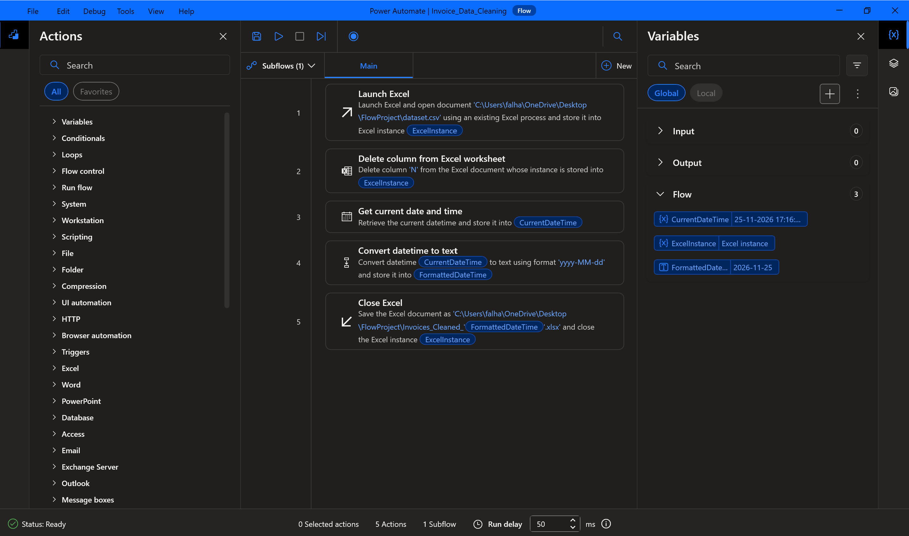
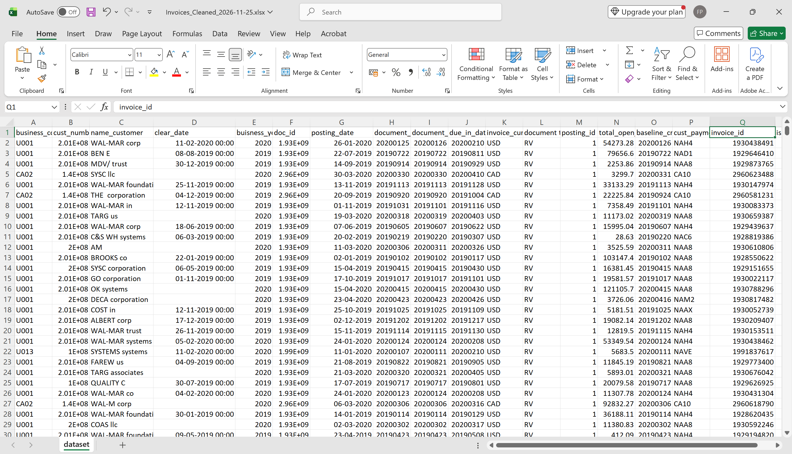

# Invoice Data Cleaning Automation 

A small desktop automation flow that cleans an invoice CSV in Excel
and saves a dated Excel report.

## What the flow does
1. Opens the invoice CSV in Excel
2. Deletes the empty `area_business` column
3. Gets today's date and formats it as yyyy-MM-dd
4. Saves the cleaned data as `Invoices_Cleaned_<date>.xlsx` and closes Excel

## Tools
Power Automate for desktop, Microsoft Excel

## Dataset
"Payment Date Dataset" (Kaggle, rajattomar132): about 50,000 invoice
records with 19 columns.

## Screenshots

## What I learned
- Building a flow with actions and variables
- Using the current date to create a unique output file name
- Automating a repeated data-cleaning task in Excel
